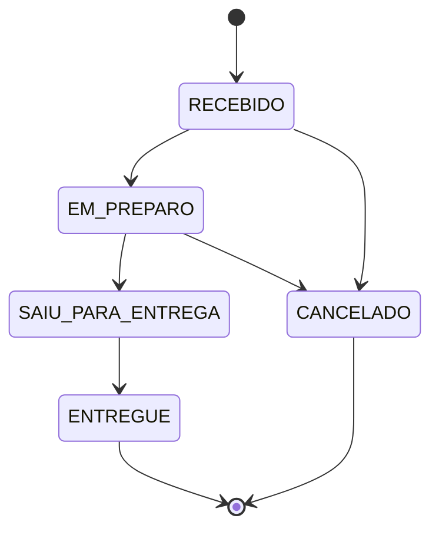

# Mini Rastreador de Pedidos

Aplicação de rastreamento de pedidos de delivery: uma API REST (Java + Spring Boot + SQLite) com cadastro e login, criação e listagem de pedidos e atualização de status com regras de transição, e uma interface React acessível que lista os pedidos com o status atual e permite criar novos.

| Camada | Tecnologias |
| --- | --- |
| API | Java 25, Spring Boot 4.1.1, Spring Security (JWT HS256), Hibernate 7, Flyway, SQLite, springdoc (Swagger) |
| Interface | React 19, TypeScript estrito, Vite, TanStack Query, Zustand, React Hook Form + Zod |
| Testes | JUnit 5 + testes de integração com SQLite real (cobertura mínima de 80%); Vitest + Testing Library + MSW + axe (mínimo de 70%) |
| Entrega | Docker Compose (nginx + JRE 25), GitHub Actions |

## Como rodar

### Com Docker (recomendado)

Pré-requisito: Docker com Compose v2.

```bash
cp .env.example .env
```

Edite o `.env` e preencha `FDL_JWT_SECRET` com o resultado de:

```bash
openssl rand -base64 32
```

Depois:

```bash
docker compose up --build
```

- Interface: http://localhost:5173 (crie uma conta em "Cadastrar" e entre)
- API: http://localhost:8080/api/v1
- Swagger UI: http://localhost:8080/swagger-ui.html
- Saúde: http://localhost:8080/actuator/health

O banco SQLite fica no volume `fdl-data`, então os dados sobrevivem a `docker compose down` e a reinícios. Para começar do zero: `docker compose down -v`.

O nginx do contêiner `frontend` serve a interface, repassa `/api/` ao back-end (o navegador fala só com a própria origem, sem CORS) e envia cabeçalhos de segurança, incluindo uma Content-Security-Policy que só aceita recursos da própria origem.

### Sem Docker

Pré-requisitos: JDK 25 e Node 22.

```bash
cd backend
export FDL_JWT_SECRET="$(openssl rand -base64 48)"
./mvnw spring-boot:run
```

Em outro terminal:

```bash
cd frontend
npm ci
npm run dev
```

A interface abre em http://localhost:5173 e o Vite repassa `/api` para o back-end em `:8080`.

### Testes e cobertura

```bash
cd backend && ./mvnw verify
cd frontend && npm run lint && npm run test:coverage && npm run build
```

O relatório do JaCoCo fica em `backend/target/site/jacoco/index.html` e o do Vitest em `frontend/coverage/index.html`. O CI (`.github/workflows/ci.yml`) repete tudo isso a cada PR.

## Roteiro com curl

Com a API no ar (por Docker ou não), cole o bloco inteiro num terminal bash. Ele cobre cadastro, login, criação, listagem, busca e atualização de status, e termina com um `400` e dois `409`. Cada execução usa um e-mail novo.

```bash
API=http://localhost:8080/api/v1
EMAIL="avaliador-$RANDOM@exemplo.com"

# 1. Cadastro (201)
curl -s -X POST $API/auth/register -H 'Content-Type: application/json' \
  -d "{\"name\":\"Avaliador\",\"email\":\"$EMAIL\",\"password\":\"senha1234\"}"

# 2. Login (200) e captura do token
TOKEN=$(curl -s -X POST $API/auth/login -H 'Content-Type: application/json' \
  -d "{\"email\":\"$EMAIL\",\"password\":\"senha1234\"}" | sed -n 's/.*"accessToken":"\([^"]*\)".*/\1/p')

# 3. Criar pedido (201, status RECEBIDO)
curl -s -X POST $API/orders -H "Authorization: Bearer $TOKEN" -H 'Content-Type: application/json' -d '{
  "customer": {"name": "Maria Silva", "phone": "11987654321"},
  "items": [{"name": "Pizza", "quantity": 2, "unitPriceCents": 4500}],
  "deliveryAddress": {"street": "Av. Paulista", "number": "1000", "neighborhood": "Bela Vista",
                      "city": "São Paulo", "state": "SP", "zipCode": "01310100"}
}' | tee /tmp/pedido.json
ORDER_ID=$(sed -n 's/^{"id":"\([^"]*\)".*/\1/p' /tmp/pedido.json)

# 4. Listar e buscar
curl -s "$API/orders?status=RECEBIDO" -H "Authorization: Bearer $TOKEN"
curl -s $API/orders/$ORDER_ID -H "Authorization: Bearer $TOKEN"

# 5. Atualizar status (200)
curl -s -X PATCH $API/orders/$ORDER_ID/status -H "Authorization: Bearer $TOKEN" \
  -H 'Content-Type: application/json' -d '{"status":"EM_PREPARO"}'

# 6. Erro 400: quantidade zero
curl -s -X POST $API/orders -H "Authorization: Bearer $TOKEN" -H 'Content-Type: application/json' -d '{
  "customer": {"name": "Maria Silva", "phone": "11987654321"},
  "items": [{"name": "Pizza", "quantity": 0, "unitPriceCents": 4500}],
  "deliveryAddress": {"street": "Av. Paulista", "number": "1000", "neighborhood": "Bela Vista",
                      "city": "São Paulo", "state": "SP", "zipCode": "01310100"}
}'

# 7. Erro 409: pular etapas (EM_PREPARO -> ENTREGUE não é permitido)
curl -s -X PATCH $API/orders/$ORDER_ID/status -H "Authorization: Bearer $TOKEN" \
  -H 'Content-Type: application/json' -d '{"status":"ENTREGUE"}'

# 8. Erro 409: e-mail já cadastrado
curl -s -X POST $API/auth/register -H 'Content-Type: application/json' \
  -d "{\"name\":\"Avaliador\",\"email\":\"$EMAIL\",\"password\":\"senha1234\"}"
```

Respostas de erro seguem o RFC 9457 (`application/problem+json`) com `code` estável e `traceId`; veja a seção [Erros](#erros).

## Ciclo de vida do status



Qualquer transição fora do diagrama responde `409 INVALID_STATUS_TRANSITION`, com o status atual e as transições permitidas no corpo. Payload inválido responde `400`.

## Decisões e trade-offs

- **Regras no domínio.** A máquina de estados fica no enum `OrderStatus` e o agregado `Order` não depende de Spring, então as regras são testáveis sem subir nada. Transição inválida é conflito de estado (`409`); payload inválido é erro do cliente (`400`).
- **Dinheiro em centavos inteiros e IDs UUID.** Evita erro de ponto flutuante e IDs previsíveis. A interface aceita reais ("12,50") e converte na borda.
- **SQLite com pool de 1 conexão e WAL.** O SQLite aceita um escritor por vez; uma conexão evita `SQLITE_BUSY` dentro da aplicação. É adequado para o desafio e não para escrita concorrente pesada. O schema é versionado por Flyway e validado pelo Hibernate (`ddl-auto=validate`).
- **Concorrência otimista.** `@Version` no pedido: duas atualizações a partir da mesma versão aplicam uma só e a outra recebe `409 CONCURRENT_MODIFICATION`.
- **Validação estrita na borda.** Jackson 3 rejeita campos desconhecidos, coerção de tipos e enum inválido, o que evita payloads ambíguos passando em silêncio.
- **JWT stateless.** Resource Server do Spring, HS256 com segredo obrigatório e TTL curto. Sem refresh token nem revogação, por escopo. No front-end o token fica em `sessionStorage` (legível por script em caso de XSS), mitigado por React escapando a saída, sem `dangerouslySetInnerHTML` e pela CSP do nginx; a evolução natural é um cookie `HttpOnly`.
- **Cadastro revela e-mails existentes** (`409`). Troca consciente de privacidade por usabilidade, documentada.
- **Paginação.** A lista devolve 100 por página por padrão (máximo 500) com `totalElements`/`totalPages`, e a interface pagina. Sem paginação, uma lista grande derrubaria o navegador.
- **Acessibilidade por construção.** Link para pular ao conteúdo, foco no `h1` a cada rota, região `aria-live`, formulários com resumo de erros focado, status sempre em texto e não só em cor, e `axe` nos testes.
- **Front-end e API na mesma origem no Docker.** O nginx faz o proxy de `/api/`, o que dispensa CORS e permite uma CSP restritiva. O CORS do back-end continua configurável (`FDL_CORS_ORIGINS`) para quem serve a interface em outro lugar.

## Estrutura de pastas

```text
backend/    API Spring Boot (auth, user, order/{api,domain,service,repository}, shared, db/migration)
frontend/   Interface React (app, features/{auth,orders}, shared, test)
openspec/   Proposta, design, specs e tarefas que guiaram a implementação
.github/    Workflow de CI
docker-compose.yml, .env.example
```

## Uso de IA

O projeto foi construído com apoio do Claude (Anthropic) seguindo o fluxo do OpenSpec: proposta, specs com cenários, design com decisões e alternativas, lista de tarefas e implementação guiada por ela, em `openspec/changes/add-order-tracking-system`. Cada tarefa tinha um critério de verificação, e cada grupo virou uma branch e um PR. Todo commit e todo push passaram por revisão e aprovação manual do autor, e o CI precisou ficar verde antes de cada merge. A IA escreveu e testou o código; as decisões de escopo e o aceite foram humanos.

## Contribuição

### Estratégia de branch

- A `main` contém apenas trabalho revisado e integrado por Pull Request; não há commits diretos nela.
- Cada grupo de tarefas do `openspec/changes/add-order-tracking-system/tasks.md` é desenvolvido numa branch curta, nomeada pelo tipo e pelo escopo: `chore/repo-setup`, `feat/backend-auth`, `feat/frontend-orders`, etc.
- Ao fim do grupo, a branch vira um PR para a `main`. O merge é feito **sem squash**, para preservar o histórico incremental.

### Commits

- Um commit por tarefa ou grupo coeso de tarefas, nunca um commit único no final.
- Mensagens no padrão [Conventional Commits](https://www.conventionalcommits.org/pt-br/): `chore:`, `feat(backend):`, `test(backend):`, `feat(frontend):`, `docs:`, `ci:`.
- O corpo da mensagem cita as tarefas atendidas, por exemplo `Refs: tasks 5.4`.

### Revisão manual

- Todo commit e todo push passam por revisão manual do autor antes de serem feitos, inclusive quando o código é produzido com apoio de IA.
- Depois que o CI (GitHub Actions, tarefas 8.4 e 9.9) estiver configurado, ele precisa estar verde antes do merge de qualquer PR.

## Front-end

React 19 + TypeScript (`strict`) + Vite, em `frontend/`. Estado em três camadas: servidor (TanStack Query), sessão (Zustand em `sessionStorage`, encerrada ao fechar a aba ou quando o token expira) e formulários (React Hook Form + Zod, nas próximas telas).

```bash
cd frontend
npm ci
npm run dev             # http://localhost:5173; o Vite repassa /api para http://localhost:8080
npm run lint            # ESLint com jsx-a11y
npm run test:coverage   # Vitest + Testing Library + MSW + axe; falha abaixo de 70% de cobertura
npm run build
```

Estrutura de `src/`: `app/` (roteador, providers, `AppShell`), `features/` (auth, orders), `shared/` (`api` com `apiClient`/`ApiError`, `session`, `ui`, `a11y`, `lib`) e `test/` (setup, handlers MSW, `renderWithProviders`). Componentes não chamam `fetch`: tudo passa pelo `apiClient`, que injeta o `Authorization`, converte `application/problem+json` em `ApiError` e encerra a sessão num `401`.

Telas de autenticação (`/login` e `/register`): formulários com React Hook Form + Zod, cujos schemas espelham as regras da API (nome 2–100, e-mail válido até 254, senha 8–72 caracteres e 72 bytes, com letra e dígito). Erros de validação ficam junto de cada campo (`aria-invalid` + `aria-describedby`) e num resumo que recebe o foco; `400` do servidor é ligado ao campo pelo `errors[].field`, `409` marca o e-mail e `401` mostra uma mensagem única ("E-mail ou senha inválidos."). Depois do cadastro o login abre com o e-mail preenchido e anuncia "Conta criada"; depois do login o usuário volta à rota que tentou acessar (`?redirect=`, aceitando só caminhos internos).

Telas de pedidos (`/orders` e `/orders/new`): a lista é uma tabela com legenda e cabeçalhos com `scope`, status em texto (`StatusBadge`), filtro por status e página na URL (`?status=&page=`), botão "Atualizar", recarga ao voltar para a aba e estados de carregamento (`aria-busy`), vazio e erro com "Tentar novamente". O formulário de novo pedido usa `fieldset`s, itens dinâmicos (1 a 50, com anúncio e foco ao adicionar/remover), total em BRL ao vivo, preço digitado em reais ("12,50") e enviado em centavos, erros `400` ligados aos campos, bloqueio de envio duplicado e, no sucesso, volta à lista anunciando "Pedido criado".

Acessibilidade por construção: link "Pular para o conteúdo", marcos `header`/`nav`/`main`, um `h1` por tela com título do documento e foco atualizados a cada rota, região `aria-live` global, `Button` com `aria-disabled` no estado pendente, `TextField` com `aria-invalid`/`aria-describedby` e `FormErrorSummary` focado. Os testes rodam o axe nas telas e nos componentes.

## Back-end

API REST em `backend/` (Java + Spring Boot, Maven). Pré-requisito: JDK 25.

### Versões efetivas

| Componente | Versão |
| --- | --- |
| Java | 25 |
| Spring Boot | 4.1.1 |
| Hibernate ORM (+ community dialects) | 7.4.5.Final |
| Flyway | 12.4.0 |
| sqlite-jdbc | 3.53.2.1 |
| springdoc-openapi | 3.1.1 |
| JaCoCo | 0.8.15 |
| Maven (wrapper) | 3.9.11 |

### Rodando

```bash
cd backend
export FDL_JWT_SECRET="$(openssl rand -base64 48)"   # sem segredo (>= 32 caracteres) a aplicação não sobe
./mvnw spring-boot:run      # sobe em http://localhost:8080 (perfil dev)
./mvnw verify               # testes unitários + integração + cobertura mínima de 80% de linhas
curl http://localhost:8080/actuator/health
```

### Configuração

| Variável | Padrão | Uso |
| --- | --- | --- |
| `FDL_DB_PATH` | `./data/fdl.db` | Arquivo do SQLite (o diretório é criado no primeiro start) |
| `FDL_JWT_SECRET` | vazio | Segredo HS256 (>= 256 bits); **obrigatório** fora do perfil `test`: sem ele (ou com menos de 32 caracteres) a aplicação não sobe |
| `FDL_JWT_TTL` | `PT60M` | Validade do token |
| `FDL_BCRYPT_STRENGTH` | `12` | Custo do BCrypt (4–15) |
| `FDL_CORS_ORIGINS` | `http://localhost:5173` | Origens permitidas |
| `FDL_SWAGGER_ENABLED` | `true` | Liga/desliga OpenAPI e Swagger UI |

Perfis: `dev` (padrão) e `test` (usado nos testes, com segredo JWT fixo).

### Banco de dados

SQLite em arquivo (`FDL_DB_PATH`), com o schema criado por migrações Flyway em `backend/src/main/resources/db/migration` (`V1__create_users.sql`, `V2__create_orders.sql`) e `ddl-auto=validate`. A conexão usa `journal_mode=WAL`, `foreign_keys=ON` e `busy_timeout=5000`, com pool de 1 conexão, porque o SQLite aceita um escritor por vez.

Tabelas: `users`, `orders`, `order_items` e `order_status_history` (`V3` acrescenta a coluna `position`, que preserva a ordem de itens e histórico). Os valores de `status` e as regras de quantidade e preço são garantidos também por `CHECK` no banco.

### Domínio de pedidos

O agregado `Order` (`com.fdl.platform.order.domain`) concentra as regras de negócio, sem depender de Spring: total calculado no servidor, status inicial `RECEBIDO` e histórico de status. As transições vivem em `OrderStatus`:

| De | Para (permitido) |
| --- | --- |
| `RECEBIDO` | `EM_PREPARO`, `CANCELADO` |
| `EM_PREPARO` | `SAIU_PARA_ENTREGA`, `CANCELADO` |
| `SAIU_PARA_ENTREGA` | `ENTREGUE` |
| `ENTREGUE`, `CANCELADO` | nenhuma (estados finais) |

Qualquer outra transição lança `InvalidStatusTransitionException`, que a API traduzirá em `409`.

### Testes e CI

`./mvnw verify` roda os testes unitários (Surefire) e de integração (`*IT`, Failsafe, com SQLite em arquivo temporário) e falha se a cobertura de linhas ficar abaixo de 80% (hoje ~96%). `OrderFlowIT` percorre a jornada completa pela API (cadastro, login, criar, listar, buscar, avançar até `ENTREGUE` e a tentativa de cancelar) e `PersistenceRestartIT` sobe a aplicação duas vezes sobre o mesmo arquivo para provar a persistência.

O workflow `.github/workflows/ci.yml` roda em todo PR e em todo push na `main`: o job `backend` (Temurin 25, cache do Maven, `./mvnw verify`) e o job `frontend` (Node 22, `npm ci`, `lint`, `test:coverage`, `build`), publicando os relatórios como artefato.

### Autenticação

Cadastro e login são públicos; todo o resto da API (exceto `/actuator/health` e a documentação OpenAPI) exige `Authorization: Bearer <token>`. O token é um JWT HS256 com `sub` (id do usuário), `email`, `name`, `iss`, `iat` e `exp`.

| Endpoint | Resposta |
| --- | --- |
| `POST /api/v1/auth/register` (`name`, `email`, `password`) | `201` com `id`, `name`, `email` (em minúsculas); `409 EMAIL_ALREADY_REGISTERED` se o e-mail existir, sem diferenciar maiúsculas |
| `POST /api/v1/auth/login` (`email`, `password`) | `200` com `accessToken`, `tokenType` = `Bearer`, `expiresIn` (segundos); `401 INVALID_CREDENTIALS` igual para senha errada e e-mail inexistente |
| `GET /api/v1/auth/me` | `200` com `id`, `name`, `email` do dono do token |

A senha precisa ter 8–72 caracteres (e no máximo 72 bytes em UTF-8, limite do BCrypt) com ao menos uma letra e um dígito, e só é guardada como hash BCrypt. Senhas e tokens não aparecem em logs: os DTOs mascaram esses campos no `toString`, e um teste de integração captura os logs em DEBUG para garantir isso. A documentação interativa está em `/swagger-ui.html` (`/v3/api-docs`).

### Pedidos

Todos os endpoints exigem `Authorization: Bearer <token>`.

| Endpoint | Resposta |
| --- | --- |
| `POST /api/v1/orders` (`customer`, `items`, `deliveryAddress`) | `201` com `Location: /api/v1/orders/{id}`, status `RECEBIDO` e `totalCents` calculado pelo servidor |
| `GET /api/v1/orders?status&page&size&sort` | `200` com `{content, page, size, totalElements, totalPages}`; cada item traz `id`, `customerName`, `status`, `totalItems` (soma das quantidades), `totalCents`, `createdAt` e `updatedAt`; padrão `page=0`, `size=100` (máximo 500), `sort=createdAt,desc` |
| `GET /api/v1/orders/{id}` | `200` com itens, endereço, `history` e `allowedTransitions`; `404 ORDER_NOT_FOUND` |
| `PATCH /api/v1/orders/{id}/status` (`status`) | `200` com o pedido; `409 INVALID_STATUS_TRANSITION` ou `409 CONCURRENT_MODIFICATION` |

Regras do payload de criação: `customer.name` 2–100 caracteres, `customer.phone` 10–11 dígitos, 1–50 itens, `quantity` inteira de 1 a 99, `unitPriceCents` de 0 a 10.000.000, `state` com 2 letras maiúsculas, `zipCode` com 8 dígitos e `complement` opcional. `id`, `status`, `totalCents` e qualquer campo desconhecido resultam em `400 MALFORMED_REQUEST`. A ordenação aceita `createdAt`, `updatedAt`, `status` e `totalCents`.

Transições de status permitidas:

| De | Para |
| --- | --- |
| `RECEBIDO` | `EM_PREPARO`, `CANCELADO` |
| `EM_PREPARO` | `SAIU_PARA_ENTREGA`, `CANCELADO` |
| `SAIU_PARA_ENTREGA` | `ENTREGUE` |
| `ENTREGUE`, `CANCELADO` | nenhuma (estados finais) |

Cada transição aceita grava uma entrada no histórico (origem, destino, usuário e data/hora UTC); transições rejeitadas não gravam. Duas atualizações do mesmo pedido a partir da mesma versão aplicam no máximo uma (`@Version`); a outra recebe `409 CONCURRENT_MODIFICATION`.

### Erros

Toda resposta de erro usa `Content-Type: application/problem+json` (RFC 9457), com `type`, `title`, `status`, `detail`, `instance`, um `code` estável e o `traceId` da requisição (o mesmo valor do cabeçalho `X-Trace-Id` e dos logs). Erros de validação trazem `errors[]` com `field` e `message`.

```json
{
  "type": "urn:fdl:problem:validation-error",
  "title": "Dados inválidos",
  "status": 400,
  "detail": "Um ou mais campos são inválidos.",
  "instance": "/api/v1/orders",
  "code": "VALIDATION_ERROR",
  "errors": [{ "field": "items[0].quantity", "message": "must be less than or equal to 99" }],
  "traceId": "7c1e2f9a-5d0b-4c3a-9a55-0e8f2b6d1c44"
}
```

| Status | `code` | Quando |
| --- | --- | --- |
| 400 | `VALIDATION_ERROR` | Bean Validation em corpo ou parâmetros |
| 400 | `MALFORMED_REQUEST` | JSON inválido, campo desconhecido, tipo errado (`1.5`, `"dois"`), enum inválido |
| 400 | `INVALID_PARAMETER` | UUID inválido no caminho, parâmetro ausente ou de tipo errado |
| 401 | `INVALID_CREDENTIALS` / `UNAUTHENTICATED` | Login incorreto / sem token ou token inválido |
| 404 | `ORDER_NOT_FOUND` / `NOT_FOUND` | Pedido ou rota inexistente |
| 409 | `INVALID_STATUS_TRANSITION` | Inclui `currentStatus`, `requestedStatus` e `allowedTransitions` |
| 409 | `CONCURRENT_MODIFICATION` / `EMAIL_ALREADY_REGISTERED` | Versão desatualizada / e-mail repetido |
| 415 | `UNSUPPORTED_MEDIA_TYPE` | `Content-Type` diferente de JSON |
| 500 | `INTERNAL_ERROR` | Sem mensagem da exceção nem pilha; o detalhe fica só no log, com o `traceId` |

O Jackson 3 é configurado de forma estrita em `JacksonConfig`: rejeita campos desconhecidos, não converte `1.5` nem `"2"` em inteiro, não lê enum em minúsculas nem por número e rejeita `null` em tipos primitivos.
